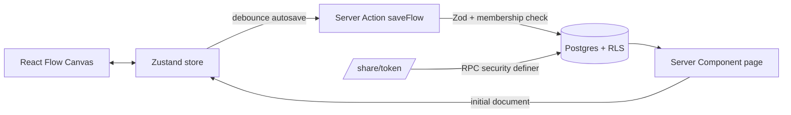

# Laneflow — Arsitektur SaaS Swimlane Diagram

## 1. Prinsip desain
- **Feature-sliced**: kode dikelompokkan per domain (`canvas`, `flows`, `workspaces`), bukan per tipe file.
- **Server-first**: halaman = Server Component; hanya canvas & form interaktif yang `"use client"`.
- **Defense in depth multi-tenant**: Row Level Security (RLS) di Postgres adalah lapisan utama; server action tetap memvalidasi (Zod) dan memeriksa membership.
- **Satu sumber kebenaran diagram**: dokumen JSON (`flows.document`) divalidasi Zod, di-hydrate ke Zustand, di-render React Flow.

## 2. Struktur direktori

```
swimlane/
├─ drizzle/                      # migrasi SQL (termasuk RLS policy)
├─ drizzle.config.ts
├─ middleware.ts                 # refresh session Supabase + proteksi route
├─ src/
│  ├─ app/
│  │  ├─ (auth)/login/           # halaman login/signup
│  │  ├─ (app)/                  # route group ber-sidebar (butuh login)
│  │  │  ├─ layout.tsx           # -> DashboardLayout
│  │  │  ├─ dashboard/page.tsx   # Recent / Templates / Drafts
│  │  │  └─ flows/[flowId]/page.tsx  # editor canvas
│  │  ├─ share/[token]/page.tsx  # view-only publik
│  │  ├─ auth/callback/route.ts  # OAuth/magic-link exchange
│  │  ├─ error.tsx, not-found.tsx, global-error.tsx
│  │  ├─ globals.css             # design tokens (tema premium)
│  │  └─ layout.tsx
│  ├─ components/
│  │  ├─ ui/                     # primitif shadcn (dikustomisasi)
│  │  ├─ layout/                 # DashboardLayout, Sidebar, Topbar
│  │  └─ shared/                 # ErrorBoundary, EmptyState, dll
│  ├─ features/
│  │  ├─ canvas/
│  │  │  ├─ SwimlaneCanvas.tsx   # React Flow wrapper
│  │  │  ├─ nodes/               # LaneNode, StepNode, DecisionNode
│  │  │  ├─ panels/              # Toolbar, NodeInspector (form SOP)
│  │  │  ├─ store/               # Zustand (+ undo/redo)
│  │  │  ├─ lib/                 # layout math, export (PNG/PDF)
│  │  │  └─ types.ts
│  │  ├─ flows/                  # FlowCard, FlowGrid, actions.ts
│  │  └─ workspaces/             # switcher, actions
│  ├─ server/
│  │  ├─ db/ (client.ts, schema.ts)
│  │  ├─ auth/ (session.ts)      # getUser, requireMembership
│  │  └─ errors.ts               # AppError, toActionResult
│  ├─ lib/
│  │  ├─ supabase/ (client.ts, server.ts, middleware.ts)
│  │  ├─ validation/ (flow.ts)   # Zod schema dokumen
│  │  └─ utils.ts
│  └─ env.ts                     # validasi env (Zod)
└─ tailwind.config.ts
```

## 3. Alur data


## 4. Model multi-tenant
`auth.users` → `profiles` (1:1) → `memberships` (N:M) ← `workspaces` → `flows`.
Setiap tabel domain membawa `workspace_id`; policy RLS: *baris terlihat bila `auth.uid()` ada di `memberships` workspace tsb*. Link berbagi memakai `share_token` acak + fungsi `security definer` agar hanya baris dengan token valid yang terbuka untuk anon.

## 5. Keputusan penting
| Topik | Keputusan | Alasan |
|---|---|---|
| Swimlane | Lane = node React Flow bertipe `lane` (parent), step = child (`parentId`, `extent: parent`) | Drag-drop antar lane native, posisi relatif otomatis |
| Persistensi | JSONB dokumen + versi optimistik (`version`) | Simpel, atomik, mencegah overwrite diam-diam |
| ORM | Drizzle | Ringan, SQL-dekat, mudah dipakai bersama RLS |
| Export | `html-to-image` + `jspdf` (client) | Tanpa server rendering, hasil identik dgn tampilan |
| Error | `AppError` + `ActionResult<T>` | Server action tidak melempar mentah ke klien |
